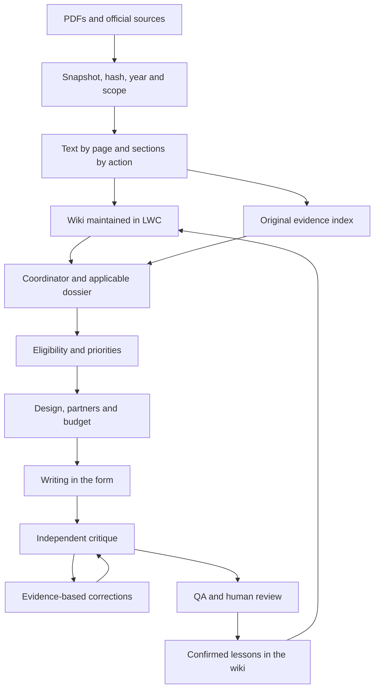

# Erasmus Designer

Local assistant for designing, writing and reviewing Erasmus+ and ESC applications with traceable sources, 30 connected skills and multi-agent coordination in Codex. The second brain maintains a wiki through **LWC 0.18.5** and a separate index of original evidence. It requires no additional API key or vector database.

## What is already operational

- **96 public or methodological sources**, including the official guides, sections of the EU web guide, Italian provisions and quality/impact tools. Private user templates are not distributed.
- **928 active evidence pages/records**, including all 456 pages of the Erasmus+ Programme Guide and all 85 pages of the expert guide.
- **50 action and sector routes: 43 Erasmus+ and 7 ESC**, with guide locators, the usual agency and application limits. For centralized actions, some aliases group lots/strands: select the actual one before writing.
- Lexical search with Italian/English synonyms, action dossier, evidence opening, hashes and immutable revisions.
- **30 skills** in `skills/`, local discovery through `.agents/skills`, **28 specialists and one orchestrator definition**, including **16 annex owners**, in `.codex/agents`, read-only LWC MCP and a limit of **four agents total**, including the coordinator.
- A sanitized KA220-YOU structural reference with **98 schemas and 346 field occurrences**. Example answers, organisations, original files and provenance were removed; it is not an official or current form and must be replaced or verified for the real call.

The action maps are **maps with excerpts and evidence**, not complete regulatory analyses of every requirement. The initial in-depth summaries cover Italian priorities, good practices and KA210/KA220 scoring grids. For an application, the agent reads the complete action section and relevant form. Broader sources outside the corpus or separate calls require specific acquisition; unretrieved URLs remain in the crawl report. [Validation](docs/validation.md) describes the verification boundary; historical repair notes remain secondary evidence rather than current instructions.

The clean distribution does not ship the local maintained LWC database, private validation receipts, or user-supplied templates. Historical release notes describe the source engine at their respective dates and must not be read as fresh verification of this clone. Use the current [architecture](docs/architecture.md), [validation rules](docs/validation.md), and [replication guide](docs/replication.md) for installation and operation.

## Starting in Codex

Reopen or reload this project to make the new skills, agent definitions and MCP available. Configuration is local only; model and subagent settings are inherited. Coordination execution depends on the multi-agent tools available in the environment; the skills remain usable sequentially if those tools are unavailable.

A useful initial request:

> Use $erasmus-designer. Help me choose the Erasmus+ action suited to this organization and these needs. Retrieve the applicable 2026 sources, verify eligibility and Italian priorities, then prepare a concept note and work plan. Flag missing data and assumptions before final drafting.

For a bounded review, use `$erasmus-evaluator` or `$erasmus-evidence-eligibility`. The coordinator selects the necessary specialists and passes them the skill, dossier and precise evidence; no role is a process already started merely because the file is present.

## Pipeline and rationale



[Karpathy's LLM Wiki](https://gist.github.com/karpathy/442a6bf555914893e9891c11519de94f) provides the sources/wiki/schema model: summaries are maintained instead of being rebuilt for every question. [LWC](https://github.com/JanYork/llm-wiki-cli) provides snapshots, provenance, citations, search and changesets: its SQLite database is canonical; Markdown is a projection. The local page index is used to check locators and Erasmus+ filters, and remains rebuildable; it does not replace the wiki as memory.

[Wayfinder](https://github.com/mattpocock/skills/blob/main/skills/engineering/wayfinder/SKILL.md) is used as a local decision map, with execution included in the notes to meet this mandate. [Map and tickets](docs/wayfinder-map.md) preserve decisions and evidence. This is an adaptation: not all software workflows from the repository were installed, nor was a planning-only phase imposed.

For a new idea, the [multi-agent loop](docs/multiagent-loop.md) begins with [Phase 0 Idea Lab](docs/phase-zero-idea-lab.md): brainstorming, route comparison, priorities, target, causality and scale, followed by `PROCEED|REFINE|PIVOT|STOP`. After fresh validation and an observed human choice, the integrated process runs the [ten application steps](wiki/topics/workflow-erasmus-esc.md), with critique at each phase and an independent evaluation of the integrated application. Corrections are closed through verifiable evidence, not because scores increase. The initial limit is three review cycles, adjustable in the workspace/dossier. The coordinator continues independent work while requesting necessary data. It retains private planning checklists, concise rationales and evidence, without requesting or storing internal chains of thought.

## Orchestrator and phase validators

[Folder architecture](docs/architecture.md) and the [orchestrator protocol](docs/orchestrator-protocol.md) define replicable dossiers. Every step has a new `fork_turns="none"` validator, distinct from the authors and all previous validators; the next step requires its report on the frozen version. Earlier products are versioned dependencies; repair/QA also receive findings and a baseline. Scripts verify contracts and hashes; the new session requires the actual observed spawn.

[The action checklists](wiki/topics/compliance-checklists.md) contain 66 checks, including 27 for KA152. Partial coverage is declared: complete verification by reading the entire route. The role of young people in exchanges must be documented in design, preparation, implementation and follow-up. The supplied DOCX is KA220-YOU, with provisional limits; for KA1, forms will be used to reconstruct questions and limits, while requirements/criteria/good practices are derived from the guides.

## Consulting the sources

Open [the wiki index](wiki/index.md), [the routes](wiki/indice-azioni.md) and [the sources](wiki/indice-fonti.md). The vault can be read in a Markdown editor or Obsidian; use LWC to modify canonical memory, without editing the `.lwc/wiki` projection.

```bash
scripts/lwc search "priorità italiane KA220 Gioventù" --limit 5
scripts/lwc page show priorita-italiane-2026
python3 scripts/brain.py dossier --action KA220 --sector ADU
python3 scripts/brain.py search "soglia minimo punteggio" --action KA220 --sector ADU --layer evidence --limit 8
python3 scripts/brain.py show programme-2026:p0242
```

These paths are examples, not an automatic choice of KA220-ADU. Erasmus+ sector codes are SCH, ADU, VET, HED, YOU, SPO; for ESC, use the [dedicated routes](wiki/research/esc-2026-routing.md). A complete code such as `KA220-SPO` infers the sector. Unindexed years and nonexistent combinations such as `KA210-HED` are rejected. A university may participate in actions in another sector if requirements allow: organization type and project sector are distinct. Erasmus+ and ESC share the working method, not the rules.

## Italian priorities and good practices

[The Italian research](wiki/research/priorita-italiane-2026.md) distinguishes INDIRE SCH/ADU and HED, INAPP VET, and AIG YOU. The four horizontal priorities are supported by INDIRE in applicable partnerships; INAPP also identifies three VET priorities; AIG highlights youth work and employability only for KA220-YOU from the March 2026 round. Areas, tie-break precedence and limits are documented there, without automatic extension to KA1, KA210-YOU or Sport.

[Good practices](wiki/research/buone-pratiche-application.md) cover documented needs, European added value, intervention logic, indicators, partners, budget, non-formal learning, priorities, safeguarding, quality, impact, communication and assisted drafting. They distinguish requirements/criteria/methods/recommendations. Use [the design dossier](wiki/templates/progettazione.md) and [the application review template](wiki/templates/revisione-application.md).

[The 2026 grids](wiki/topics/griglie-ka210-ka220-2026.md) distinguish KA210 and KA220: thresholds, maximum amounts and contributions are not interchangeable. The [note on conflicts](wiki/topics/conflitti-fonti.md) preserves the inconsistency in expert guide p.70 on the denominator for the KA220 management budget: the operational limit is 20% of the total, confirmed by the Programme Guide and 2026 manual. An assistant score is a reasoned simulation; funding depends on the actual selection.

## Separate projects and replication

Every new application lives in `projects/<name>--<action-type>--<year>/`; the engine and second brain are shared. [Creating dossiers](docs/project-creation.md), the [complete schema](docs/architecture.md), [replication on another computer](docs/replication.md), and [validation](docs/validation.md) describe procedures and outstanding issues.

## Dossier and agentic loop register

The loop is run by the Codex agent. `workflow.py` retains phase reports and checks order, frozen versions, blockers and the revision limit; it does not call LLMs or independently verify whether a requirement is substantively met.

```bash
python3 scripts/workflow.py idea-init idea-name --title "Idea title" --year 2026 --max-revisions 3
python3 scripts/workflow.py idea-status idea-name--2026

# after product, packet, fresh validator and observed human PROCEED choice
python3 scripts/workflow.py promote-idea idea-name--2026 --project-name project-name --title "Project title"

# explicit import of already routed work; marks Phase 0 as bypassed
python3 scripts/workflow.py init project-name --title "Project title" --action KA220 --sector YOU --process integrated --max-revisions 3
python3 scripts/workflow.py status project-name
python3 scripts/stage_gate.py prepare project-name --phase idea-validation --report projects/project-name--ka220-youth--2026/reports/idea-validation.json --producer-id ACTUAL_PRODUCER_ID
# The orchestrator starts and records a NEW fork none validator; use the observed IDs.
python3 scripts/workflow.py record project-name --phase idea-validation --report projects/project-name--ka220-youth--2026/reports/idea-validation.json --validation-packet PACKET_ID --validation-report projects/project-name--ka220-youth--2026/validation/reports/ACTUAL_REPORT.json
```

Every report contains `status` (`pass`, `blocked`, `needs-revision`), `summary`, `evidence` with `source_id` and `locator`, and `blockers`. In the integrated process it also contains `critical_review` with `weaknesses`, `alternative` and `decision_basis`. Local data use explicit provenance and a path within the dossier. The integrated process is the default: ten work steps correspond to twelve register phases (`idea-validation`, `needs-impact-research`, `concept-note`, `intervention-design`, `work-packages`, `partner-concept`, `answer-outlines`, `application-draft`, `annexes`, `review`, `repair`, `qa`); repair is optional and QA closes step 10. The historical eligibility → design → draft → review → repair → QA path remains selectable with `--process compact`.

Before drafting answers, `workflow.py bind-form` associates a relevant profile with the dossier, supported by evidence of the form/round and a matrix of applicable fields. The shared model feeds answers and annexes; before review, text, form profile, data and annexes are frozen with hashes. Review/QA requires `draft_sha256` matching the frozen version. `workflow.py invalidate` reopens the first affected production phase when changes are made; replacing the profile through the binder reopens answer planning when necessary. Findings in `findings.json` retain criterion, severity, evidence, correction and status; QA does not pass with unverified blocking/major findings. The register checks contracts and file integrity: it does not by itself prove semantic correctness, eligibility or legal validity. The final submission remains subject to content review by the organizations.

For question and annex planning, see the [KA220 playbook](wiki/templates/ka220-question-playbook.md), [response contract](wiki/templates/response-contract.md), [shared model](wiki/templates/project-memory-contract.md) and [annex catalogue](wiki/templates/annex-template-catalog.md). Limits and mandatory fields in the 2025 model must be checked against the current form; examples and recommendations in tables are not project facts. A partner agreement may be a discussion draft, while a signature-ready version requires the relevant legal review.

## Updates and maintenance

For an application, recheck the guide/corrigenda, national provision, round, deadline and form **online**. The local check does not attest to online freshness. The `year` field indicates the corpus's applicable year; older standards retain `publication_year`, when known, and do not become a 2026 call.

```bash
python3 scripts/brain.py check
scripts/lwc lint
python3 scripts/verify_retrieval.py
python3 -m unittest discover -s tests -v
```

For new sources, add precise metadata to the catalogue, acquire/check the originals and rebuild the index. `brain.py download --refresh` preserves changed originals in `raw/history`; indexed records point to immutable revisions. `brain.py rebuild` does not replace the agent's regulatory analysis. Do not rerun `seed_catalog.py` on an existing catalogue.

Wiki updates use LWC changesets, preserve valid citations and resolve conflicts before commit. `sync_lwc.py` is the bootstrap compiler for maps and editorial pages: do not run it blindly on enriched memory. First verify the changes and IDs to preserve. Fixed retrieval checks must be run on the draft and again on live after commit. Back up LWC using a CLI checkpoint, or by copying all of `.lwc/` when there are no writers; do not copy only the database while WAL is active.

The LWC `--changeset` flag queries only the overlay of modified pages, without merging it with live: check new queries on the draft and regressions on live before and after commit. See the [official LWC workflow](https://github.com/JanYork/llm-wiki-cli/blob/main/docs/agent-workflow.md) and the local [knowledge-maintenance process](docs/knowledge-maintenance.md).

LWC is installed in `vendor/lwc`, with a locked package and SHA256/binary version verification. The index requires Python 3.11+ with SQLite FTS5 and Poppler `pdftotext`; the official LWC CLI is independent of the Node runtime once the binary is installed. The code does not use generation APIs. Local configurations follow [Codex skills](https://learn.chatgpt.com/docs/build-skills) and [Codex subagents](https://learn.chatgpt.com/docs/agent-configuration/subagents); detect the environment's actual capabilities after reload.

Before each step, use the [dossier checklist](docs/checklist-workflow.md); financial checks follow the [action modes matrix](docs/action-modes.md). At startup, obtain the [current form](docs/form-intake.md) from the user or authorized platform. [Private releases](docs/release-bundles.md) include ZIP files and checksums, separate canonical memory, a runtime to reinstall, and a [read-only path audit](docs/relocation.md) for transferred dossiers. A verified local archive does not attest that another PC is already operational.

## Working memory and call updates

Use [erasmus-project-memory](skills/erasmus-project-memory/SKILL.md) whenever resuming work: decisions, facts, hypotheses and open questions have a persistent register for each application, indexed and separate from the data model and gates. The engine itself uses `--engine-memory`; its decisions are included in replication. [Procedures](docs/project-working-memory.md).

Use [erasmus-knowledge-maintenance](skills/erasmus-knowledge-maintenance/SKILL.md) to acquire and compare updated Erasmus+/ESC guides, expert guides, priorities and forms. The comparison covers complete schemas and per-instance limits; new years and fields remain candidates until integrated and verified. No silent replacement of the call or existing answers. [Maintenance](docs/knowledge-maintenance.md).

To install the package on another computer, follow [the quick guide](docs/quick-start-another-computer.md) and the detailed [replication guide](docs/replication.md).

## Corrections after the September 13, 2026 audit

The current revision includes [Wayfinder for applications](docs/wayfinder.md), [approval of the exact QA package](docs/human-approval.md), [recovery of interrupted cycles](docs/dispatch-recovery.md), [protected LWC bootstrap](docs/bootstrap-safety.md), and [repeatable synthetic evaluations](docs/evaluation.md). [Instructional calibration](docs/evaluator-calibration.md) uses only aggregate rewritten practices: it does not retain private originals or modify model weights. Gate status is read from the relevant receipt, never inferred from the presence of files.
