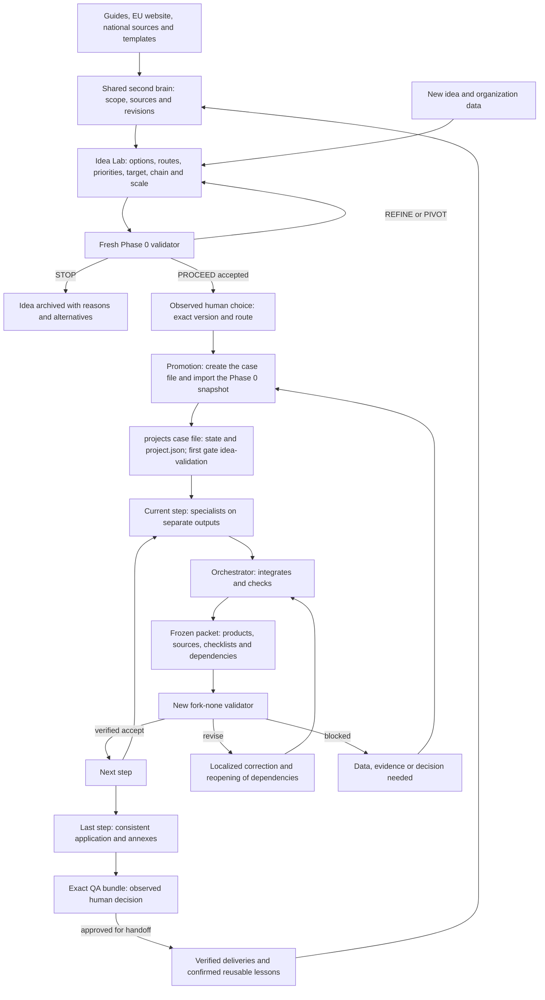

# Erasmus+ and ESC System Architecture

Erasmus Designer is the shared engine. Applications are separate folders inside projects/: they share sources, capabilities and checks, but retain their own data, answers, annexes and history. There is no need to create a new agent installation for each application.

## General structure

```text
ERASMUS DESIGNER/                    engine root, to open in Codex
  AGENTS.md, README.md               shared rules and startup
  config/                            actions, sources, forms, checklists, owners, layouts and gates
  skills/                            capabilities selectable from the current catalog
  scripts/, tests/                   generator, retrieval, checks and regressions
  docs/                              procedures, decisions, audits and replication
  raw/                               originals and external snapshots
  sources/                           extractions and immutable revisions by hash
  wiki/                              shared regulatory/methodological summaries and templates
  .lwc/                              canonical memory maintained through the CLI
  index/                             rebuildable evidence index and engine receipts
  vendor/lwc/                        manifest/lock; runtime for this platform
  .codex/, .agents/                   native configuration/discovery generated for this root
  work/engine-memory/                persistent decisions for the engine project
  work/idea-lab/<name>--<year>/      Phase 0 before choosing the route
  projects/
    README.md                        instructions for creating and resuming case files
    <name>--<action-type>--<year>/     one application, with its own tree
```

Hidden folders are part of the installation, but have different authority: `.lwc/` is memory to preserve; `.codex/` and the `.agents/skills` link are surfaces to regenerate on a new computer. `index/evidence.sqlite` does not replace the LWC DB. A copy of the wiki Markdown files alone does not replicate all maintained memory.

## An application case file

```text
projects/bridge--ka220-youth--2026/
  AGENTS.md, README.md
  brief.md, project.json, evidence.json
  answers.json, draft.md, annex-manifest.json
  state.json, findings.json
  inbox/, research/, design/, partners/, application/
  memory/                           decisions/facts/hypotheses, log and local index
  wayfinder/                        decision map, dependencies and historical snapshots
  approval/                         observed decisions on the exact QA bundle
  annexes/<tipo>/
  production/<phase>/<attempt>/      exclusive producer outputs
  stages/<phase>/product.md          actual integrated product
  validation/packets/<packet-id>/    snapshot, manifest/hash, checklist and schema
  validation/dispatches/             receipts for observed spawns
  validation/reports/               exclusive outputs from new validators
  sessions/                         actual tool observations and IDs
  reports/, receipts/               production reports and verifiable history
  exports/                          deliveries derived from the verified version
```

The generator prepares the empty registers and phase folders for the selected process. Attempts, products and packets are created only during actual work. `project.json`, version `project-model-v2`, is the single model for IDs, partners, needs, objectives, activities, WPs when relevant, tasks, deliverables/versions, milestones, calendar, results, budget and KPIs. Owners use the verified register projections with the same IDs. `answers.json` contains the field responses; draft.md is their canonical presentation. The application/exports folders hold work and deliveries without creating alternative numeric registers.

The presence of a workspace does not attest that it is a required upload. The manifest distinguishes internal, optional and required annexes, with evidence from the actual call/form. The project has a single program/action/sector/year identity, with the form profile verified before drafting; do not copy rules or forms from one type to another.

## How the work flows



Phase 0 is a pre-process: open brainstorming, comparison of routes and the `PROCEED|REFINE|PIVOT|STOP` decision. `PROCEED` does not make the idea definitively eligible for an application; it only allows the case file to be created after the observed human choice. The application process then retains its ten steps: formal idea validation and award checklist, needs/impact research, initial concept, intervention logic, activities/WPs and partner tasks, partner concepts, response plans, application drafting, annexes, evaluation/corrections/QA. The register has twelve phases: repair is optional and QA closes step10. **Every completed phase, including Phase 0, has a new validator**. A phase gate does not replace evaluation of the complete application against the award criteria.

## Responsibilities and scale

The orchestrator is the sole integrator of the shared model: it selects sources, sets acceptance criteria before production, assigns owners and exclusive paths, preserves state/versions and decides what to reopen. Specialists propose and materialize distinct products. The validator is new, not an author and not a previously used validator; it receives the corpus and packet, without production chat or a suggested outcome.

Four agents in total means three children plus the coordinator. The local configuration sets max_concurrent_threads_per_session=3, because the OpenAI documentation excludes the primary from the child count. [Official subagent configuration](https://learn.chatgpt.com/docs/agent-configuration/subagents). These are not 29 permanent processes: only the necessary capabilities are loaded. Dispatch is serial, one at a time; independent production outputs may proceed in parallel.

New applications add case files; new types add compatible profiles/checklists while retaining the same contracts. New years require new sources and verification of differences: corpus2026 is not automatically applied to a different year. Reusable lessons are published after confirmation, with scope and evidence; data from one application do not become general rules.

## Generation, replication and limits

[Creating case files](project-creation.md) describes workflow init and the maintained layout; [orchestrator-protocol.md](orchestrator-protocol.md) governs mandates, gates and reopening; [replication.md](replication.md) separates transfer of the engine, memory and applications. The [memory contract](../wiki/templates/project-memory-contract.md) defines shared data, and [validation](validation.md) states the current verification boundary.

The scripts check declared scope, sequence, hashes, references, counts and main numerical relationships. Substantive verification is required for merit, impact causality, partner capabilities and program criteria. A new fork-none conversation does not amount to filesystem/provider isolation. Future transfer of receipts with frozen paths requires mapping and a new baseline; the system does not rewrite them automatically. The structure by itself does not demonstrate compliance or readiness for submission.

Engine0.2.0 introduced [mode matrix](action-modes.md), [case-file checklist](checklist-workflow.md), [form intake](form-intake.md), [release with manifest](release-bundles.md) and [relocation audit](relocation.md). [Corrections0.2.1](repairs-0.2.1.md) strengthen these contracts, the shared registers and evidence integrity. The orchestrator skill references them; call data and gaps remain in the individual case file. Each checklist-specific extension is frozen and must be assessed in the independent report.

## Working memory and annual maintenance

The shared LWC regulatory memory and [working memory](project-working-memory.md) have different authority: a case-file decision does not become a general rule. The append-only register and indexed context allow work to resume without prior chat; `project.json` and the gates remain separate. The engine keeps its own decisions in work/engine-memory.

[Maintenance](knowledge-maintenance.md) compares complete assets and profiles, including limits, conditional/repeated fields and criteria. A candidate revision requires dependency integration, testing and a new validator before promotion; unsupported years remain staged. The [short replication guide](quick-start-another-computer.md) distinguishes software installation from memory import and host reload.

The [Wayfinder map](wayfinder.md) organizes research and dependent decisions without replacing the model, tasks or gates; the [human decision](human-approval.md) binds consent to the bytes of the active QA bundle. Changes make consent stale and require the relevant gates. [Recovery](dispatch-recovery.md) preserves consumed attempts and the identities of interrupted dispatches. [Synthetic evidence](evaluation.md) distinguishes model behavior, structural checks and host authentication limits.

## Project design methodology

The [design contract](design-methodology.md) connects participatory diagnosis, gaps/causes, objectives, Theory of Change, logical framework and SMART/RACER to applicable criteria and each question/instance. Handbook2026 and Impact Tool KA1/KA2 have distinct scopes in `config/design-methodology.json`. The `method-*` checks belong to the authorized method. Design and answer plans are versioned step-products, not alternative numeric models and not automatically required annexes.
